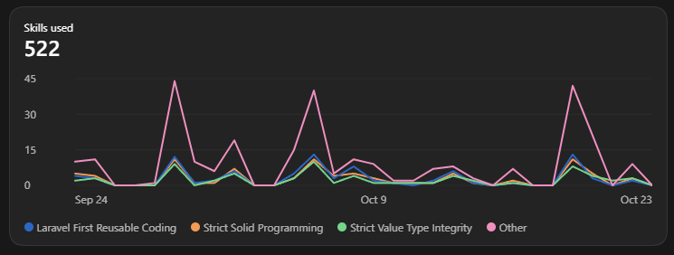

# Reviewer notes

## How did you design templates so any criteria can be checked?

Each criterion stores a question, instructions, an explicit PASS standard, applicability guidance, weight (importanance), and display order. New questions need no code changes. Published versions are immutable and linked to their evaluations so we have a clean history if something was evaluated with some verions that's no longer applicable. The LLM judges criteria PHP calculates scores. Version one supports pass/fail, insufficient evidence, and not applicable.

## Where does the tool get it wrong, and how would you catch that?

Whisper can mistranscribe, and Qwen3-14B (my local LLM) can misattribute speakers or choose weak evidence. One acknowledgment result cited the caller’s question rather than the agent’s invitation. Timestamped audio, stored transcript references, and human review expose these mistakes. I would measure criterion-level disagreement against independently reviewed calls and inspect recurring override patterns, besides this is running a local AI setup, so the better the model, the better the results.

## What would you build next with another month?

Priorities would be calibration against representative insurance calls, better speaker attribution, richer processing diagnostics, and review queues. I would improve measured accuracy before expanding scoring types or analytics. another thing would be data collection, if I have a lot of data, I can target what requires the most attention to be improved over time.

## Where did AI help, and where did it get things wrong?

### Where the AI Helped:
AI assisted with Laravel/Livewire implementation, local model demo integration, script configuration for one command setup, an early approach used a whole transcript size, where I uploaded a longer audi file the transcript went beyond screen sizes, AI fixed layout and limitation, and another initial verion I implemented allowed for 1 upload at a time, AI using the same logic added support for zip files and file validation. Research and examples to setup sequencial context windows for larger audi files which take too much hardware resources. and primarily, most methods written were first written by hand then were refactored into proper, SOLID principled requests.

### Where the AI Took It Wrong:

AI often struggles to collect evidence, process unstructured information, and follow consistent standards without clear guidelines or skills.

I personally use AI professionally to write code and execute implementations strictly within my own guidelines and specifications.

**To keep it short, every skill I've created exists because AI got something wrong.** Instead of repeatedly correcting the same mistakes, I turn them into reusable skills to prevent them from happening again.

The screenshot shows **522 skill usages**, not 522 mistakes, but 522 instances where my corrective guidelines were applied.

## TO THE REVIEWER
#### I created the repository in the end and after testing the application, everything was commited in order of feature (following gitflow standards) but when I pushed to the git repository every timestamp was stamped 'now'
